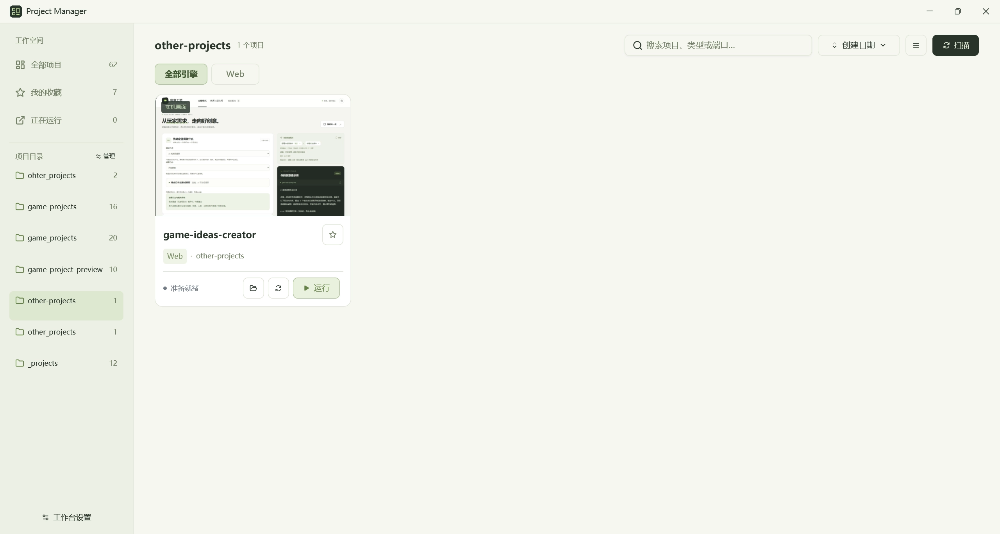
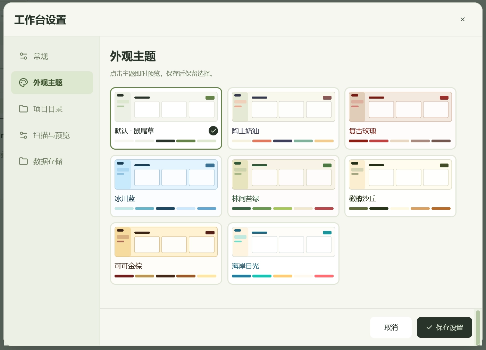
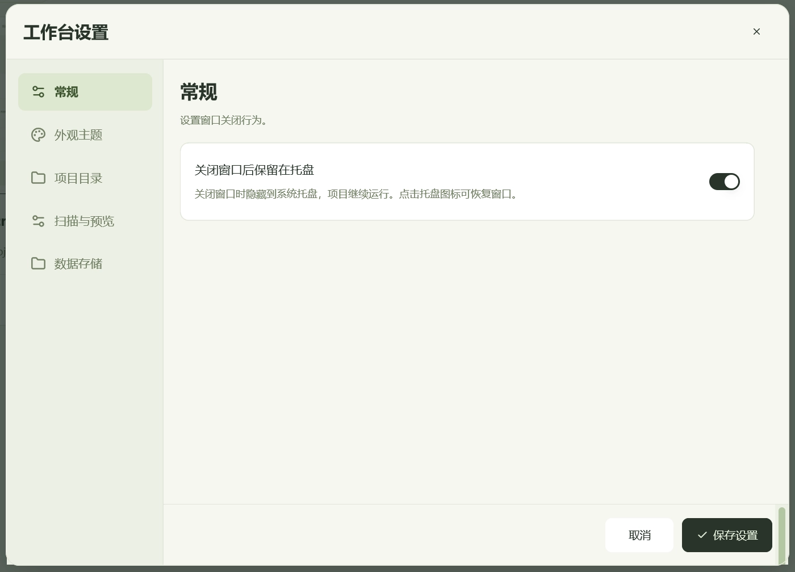

<p align="center"></p>
<h1 align="center">Project Manager</h1>
<p align="center"><a href="README.zh-CN.md">简体中文</a> · <a href="https://github.com/bucool/project-manager/releases/latest">Download</a></p>

A native Windows app for managing local web projects, tools, and games. Browse cached previews, organize multiple project folders, install dependencies, start or stop development servers, and inspect errors from one workspace.

<p align="center">
  <a href="docs/images/project-library.webp"></a>
  <br><sub>Project library · Cached previews · Multiple folders</sub>
</p>

<table>
  <tr>
    <td width="50%" align="center">
      <a href="docs/images/appearance-themes.webp"></a>
      <br><strong>Appearance themes</strong>
    </td>
    <td width="50%" align="center">
      <a href="docs/images/system-tray.webp"></a>
      <br><strong>System tray settings</strong>
    </td>
  </tr>
</table>

Starting a project refreshes its cached preview in the background and enables LAN preview. Copy its LAN link from the card or project details and open it on a device on the same network. Stopping the project closes the LAN preview too.

Enable **Keep running in the system tray on close** in **Settings → General** to hide the window while projects keep running. Click the tray icon to restore the window, or right-click it and choose **Exit** to quit. This option is off by default. Opening the app again brings the existing window to the front, including when it is hidden in the tray.

Built with **Rust + GPUI**. Previews use the system **Microsoft Edge WebView2 Runtime**, started only for capture and closed afterward. An on-demand Node.js worker manages projects and development servers. Choose your data folder on first launch; it can be changed later in Settings. Project data and runtime preview caches stay local; only the selected documentation images are published.

Notes are available from the sidebar, with tabs, automatic saving, single-pane Markdown editing with a separate preview mode. Pasted images (Ctrl+V) are inserted at the cursor as local Markdown image links. Change the notes folder in **Settings → Notes**; existing notes and images are moved to the new folder after verification. Notes stay local.

## Download

Download the Windows x64 portable ZIP from [Releases](https://github.com/bucool/project-manager/releases/latest), extract the **entire archive**, and open `project-manager.exe`. New builds include Node.js but no bundled browser or Playwright. Preview capture requires [WebView2 Runtime](https://developer.microsoft.com/microsoft-edge/webview2/), already present on most Windows PCs. Individual managed projects may still need their own package managers and dependencies. The interface defaults to your Windows display language: Simplified Chinese for Chinese systems, English otherwise. Choose **Follow system**, **简体中文**, or **English** in **Settings → General → Interface language**. Changes preview immediately; save to keep your choice.

## Build

Requirements: Windows 10/11 x64, stable Rust MSVC, Visual Studio C++ Build Tools with Windows SDK, Node.js 20+, and WebView2 Runtime for previews.

```powershell
git clone https://github.com/bucool/project-manager.git
cd project-manager
powershell -NoProfile -ExecutionPolicy Bypass -File scripts/build-native.ps1 -Release
.\target\release\project-manager.exe
```

Omit `-Release` for a Debug build. The script locates the SDK's `fxc.exe` and `rc.exe`; for custom locations, set `GPUI_FXC_PATH` and `GPM_RC_PATH`. Keep source-built executables inside the checkout so they can find `runtime/`.

To create a portable ZIP after building Release:

```powershell
powershell -NoProfile -ExecutionPolicy Bypass -File scripts/package-release.ps1
```

Only run projects you trust: development commands and dependency installs execute project code. Settings and previews stay in your chosen local data folder; the application does not upload them.

## License

[MIT](LICENSE). Built with [GPUI](https://github.com/zed-industries/zed/tree/main/crates/gpui), [gpui-component](https://github.com/longbridge/gpui-component), and [WebView2](https://developer.microsoft.com/microsoft-edge/webview2/).
